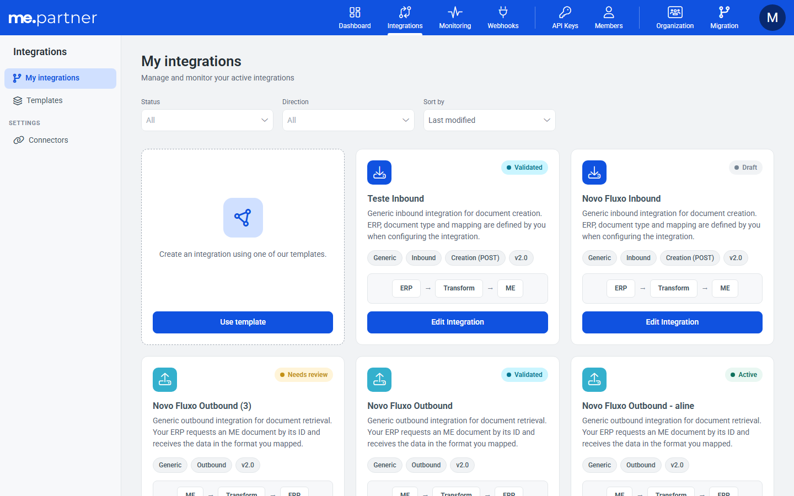

# Card fixo pra criar integração em Minhas integrações

## Resumo
Minhas integrações ganhou um card fixo no início do grid pra criar uma integração nova a partir de um template.

## Problema
O grid de Minhas integrações não tinha um atalho pra criar uma integração nova a partir de um template.

## Por que
Deixar a criação a partir de template ao alcance direto na lista de integrações.

## Como
- **`EmptyState`:** o `title` passa a ser opcional, e o `<h2>` só renderiza quando há título. Os usos existentes já passam título e não mudam.
- **Card fixo:** reaproveita o layout do estado vazio (ícone, texto e botão "Usar template"), sem o título, como primeiro item do grid. Tem fundo branco, borda tracejada e botão de largura total alinhado aos botões dos outros cards. O botão leva pra tela de Templates.
- **Quando aparece:** só quando a lista tem pelo menos um resultado (sem filtro com integrações, ou filtro que retornou algo). Filtro sem resultado continua mostrando o estado de "sem resultados". Depois, a [MW-93182](../2026-11-11_MW-93182_busca-status-contraste-my-integrations/README.md) mudou a regra: o card some sempre que há filtro ativo.
- **Testes:** integrações sem filtro, filtro com resultado, filtro sem resultado e lista vazia.

## Onde
partner-portal: tela Minhas integrações, componente `EmptyState`

## Resultado / impacto
O usuário cria uma integração nova a partir de template direto do grid.

## Imagens

