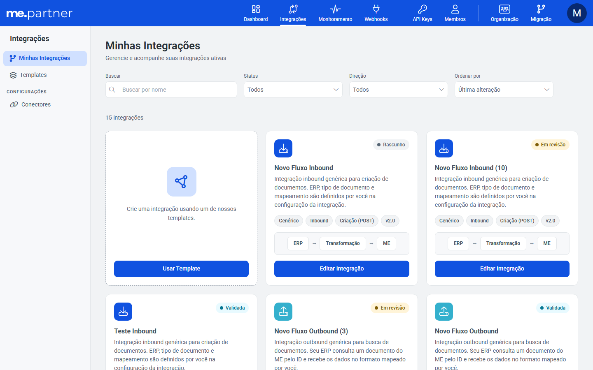
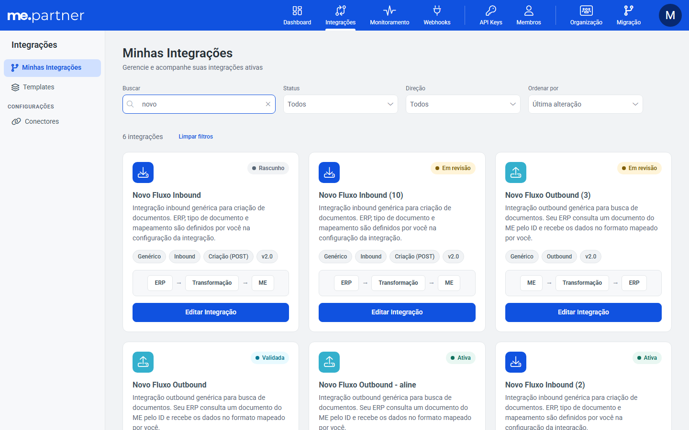
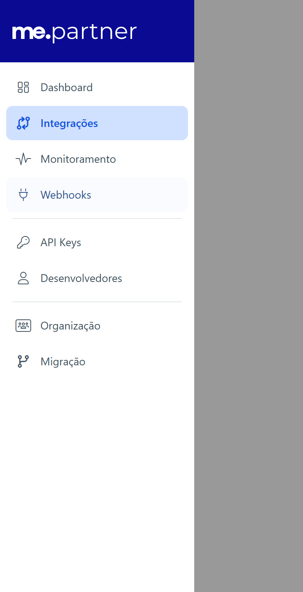

# Minhas integrações: busca, status, contraste e ajustes de mobile

## Resumo
Minhas integrações ganhou busca por nome, total de resultados e "Limpar filtros". Os status foram padronizados, o contraste passou de 4,5:1, e no celular as abas e o menu hambúrguer foram corrigidos.

## Problema
Pontos apontados na análise de UI/UX da tela:
- não dava pra buscar uma integração pelo nome;
- o filtro "Todos" parecia desabilitado;
- os status misturavam gêneros;
- os selos e o menu lateral tinham contraste baixo;
- no celular, as abas se sobrepunham e o menu hambúrguer era uma pilha de botões.

## Por que
Facilitar achar uma integração e corrigir textos e contraste apontados na análise de UI/UX.

## Como
- **Busca:** campo `me-text-input type="search"` antes dos filtros. Filtra no front, porque a lista já vem inteira. Ignora maiúsculas, acentos e espaços nas pontas e combina com Status e Direção.
- **Total e "Limpar filtros":** mostra "N integrações", com singular e plural. "Limpar filtros" aparece só com filtro ativo, zera busca, Status e Direção, mantém a ordenação e também aparece no estado sem resultados.
- **Card fixo de criar:** some sempre que há filtro ativo. Isso muda a regra da [MW-93020](../2026-11-06_MW-93020_card-criar-my-integrations/README.md), em que o card aparecia com filtro que trazia resultado.
- **Filtro "Todos":** deixa de ser placeholder do `me-select` e vira opção real da lista, sem CSS por cima do componente.
- **Status no feminino:** Rascunho, Em revisão, Validada, Ativa e Suspensa (e os equivalentes em es e fr), no card, no filtro e no selo do cabeçalho do assistente.
- **Textos:**
  - o "ativas" saiu do subtítulo nos 6 idiomas, porque a lista mostra todos os status;
  - o passo "Transform" do desenho do fluxo passa a vir do i18n.
- **Contraste:** troca de tokens nos selos Rascunho, Em revisão e Validada e no rótulo "Configurações" do menu lateral. Conferido com axe-core: nenhuma falha de contraste na tela.
- **Menu hambúrguer:** o conteúdo da gaveta vira o componente `AppSideMenu` (`<nav><ul>` com links), usado nos layouts `default` e `integrations` no lugar do slot repetido.
  - Cada item tem ícone, hover e separador entre grupos.
  - O item atual fica destacado com `aria-current`.
- **Mobile:** as abas do `AppSidebar` ficam com a largura do texto e rolagem horizontal, o que corrige também o Monitoramento. A toolbar ganhou 16px entre os campos.

## Onde
partner-portal: Minhas integrações, `AppSideMenu`, `AppSidebar`, layouts `default` e `integrations`, selos de status, arquivos de i18n

## Resultado / impacto
Achar uma integração ficou mais rápido, os status ficaram consistentes em todo o portal, a tela passa no axe sem falha de contraste, e o menu e as abas funcionam no celular.

Ficam pra depois:
- O nome da seção no cabeçalho mobile e o menu superior estourando entre 769 e ~1040px dependem do `Header.vue` do me-toolkit.
- O `<li>` fora de lista apontado pelo axe vem do `SelectOption.vue` do me-toolkit.

## Imagens
Sem filtro, com o card de criar:

Busca com total, "Limpar filtros" e sem o card de criar:

Menu hambúrguer como lista:

Outros prints no MR: filtro de Status, estado sem resultados, celular em 375px e Monitoramento.
