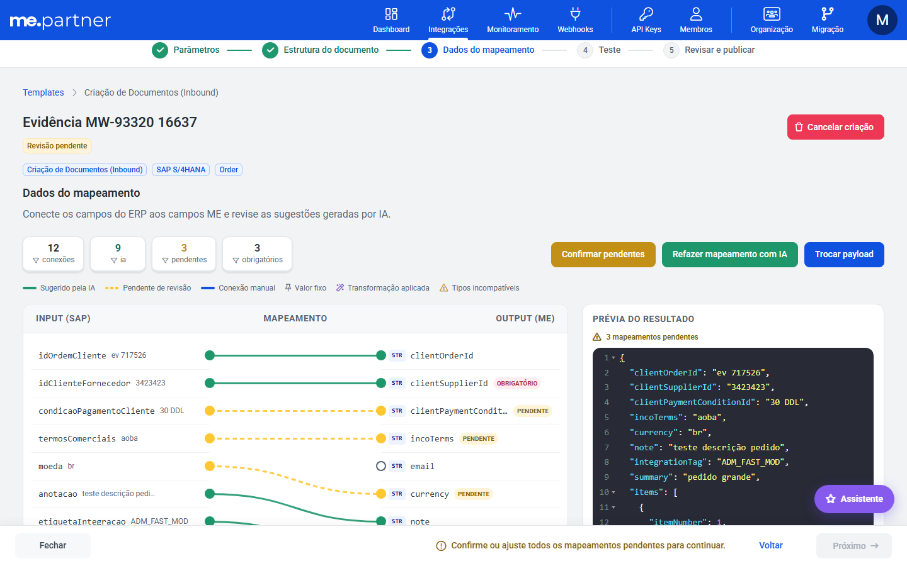
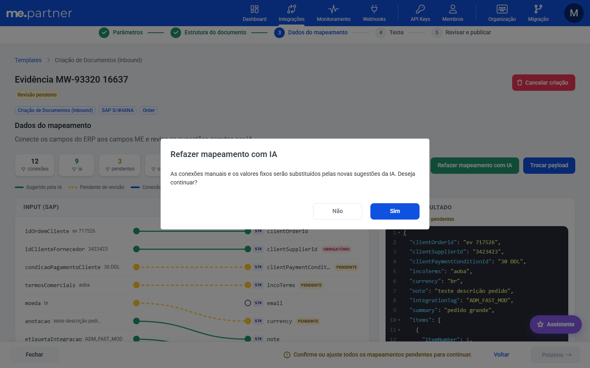

# Melhorias de UX no assistente de criação de integração

## Resumo
Apliquei as melhorias do Raio-uX nas 5 etapas do assistente de criação de integração. Agora ele deixa claro o que falta pra avançar, pede confirmação antes de apagar trabalho ou pular validação e ficou mais acessível por teclado e leitor de tela.

## Problema
Pontos do Raio-uX no assistente:
- não ficava claro o que faltava pra avançar;
- "Cancelar" dava a impressão de apagar o trabalho;
- "Refazer mapeamento com IA" e "Pular teste" rodavam sem confirmação;
- partes do mapeamento não eram acessíveis por teclado nem por leitor de tela.

## Por que
Menos erro e menos trabalho perdido no fluxo principal do portal, além de acessibilidade.

## Como
- **Barra de etapas e cabeçalho:** sai o contador "N de 5 etapas". Entra uma lista ordenada com `aria-current="step"` e mais contraste nas etapas concluídas e pendentes. A etapa 3 passa a se chamar "Dados do mapeamento".
- **Rodapé:**
  - "Cancelar" vira "Fechar", que só navega e não apaga nada;
  - os avisos ficam em cor de aviso;
  - na etapa 4, o aviso explica o que falta pra avançar, com texto próprio pro fluxo de saída sem "Pular teste".
- **Parâmetros:**
  - "Nome do novo ERP" ganha rótulo próprio;
  - a URL do endpoint não quebra mais a linha;
  - o lápis do título vira botão com a dica "Renomear integração".
- **Estrutura do documento e mapeamento:**
  - os editores de JSON têm rótulo pra leitor de tela;
  - a área de campos do mapeamento é acessível por teclado;
  - os rótulos dos campos têm mais contraste.
- **Mapeamento pendente:** selo "Pendente" nos campos ME e aviso "N mapeamentos pendentes" na prévia do resultado.
- **Confirmações:**
  - modal antes de "Refazer mapeamento com IA", que substitui conexões manuais e valores fixos;
  - modal antes de "Pular teste".
- **Revisar e publicar:** aviso de publicação com `me-alert` e coluna de rótulos alinhada nos cards.
- **i18n e testes:** textos novos nos 6 idiomas e testes unitários atualizados.

## Onde
partner-portal: assistente de integração (barra de etapas, rodapé, Parâmetros, Estrutura do documento, Dados do mapeamento, Revisar e publicar), arquivos de i18n

## Resultado / impacto
O usuário sabe o que falta pra avançar, não perde mapeamento manual nem pula o teste sem confirmar, e o assistente funciona melhor com teclado e leitor de tela.

Ficam pra depois:
- O axe ainda aponta contraste fora deste MR: botão de excluir, botões amarelo e verde da etapa 3, números de linha do editor, botão "Assistente" e seletor de ERP (me-toolkit).
- No celular, o botão "Assistente" cobre parte do aviso do rodapé.
- As ideias que ficaram de fora estão na PD-3935.

## Imagens
Dados do mapeamento, com o selo "Pendente", o aviso na prévia e o aviso no rodapé:

Confirmação de "Refazer mapeamento com IA":

Outros prints no MR: Parâmetros, confirmação de "Pular teste" e Revisar e publicar.
