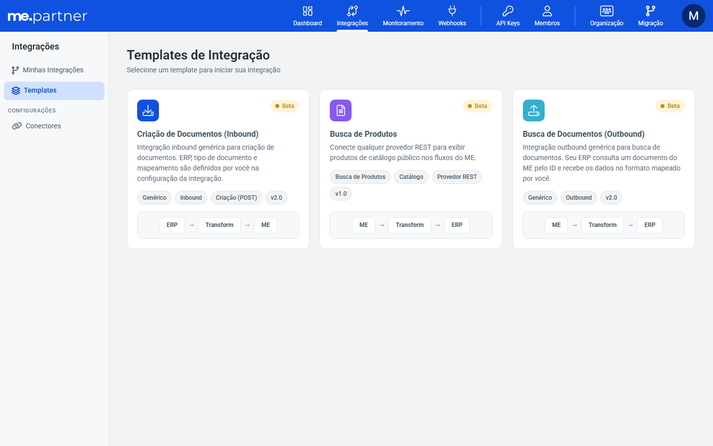
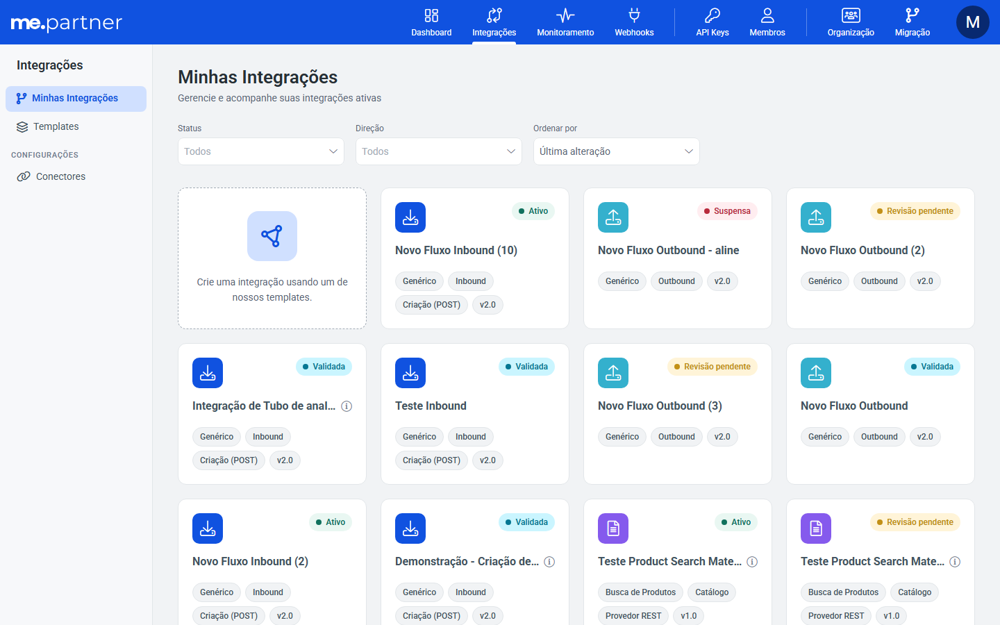
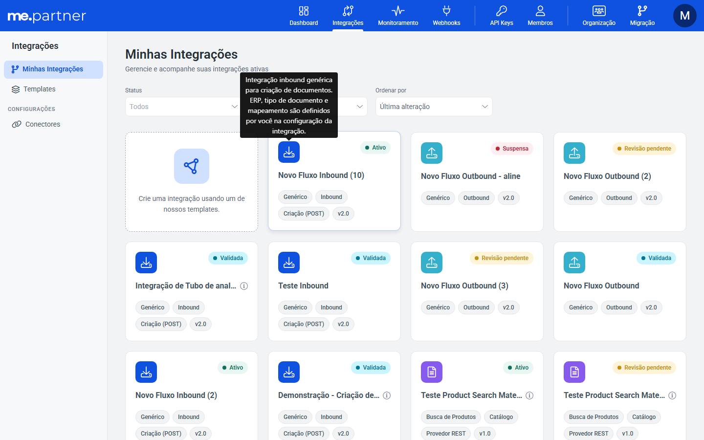

# Cards de Templates e Minhas integrações clicáveis por inteiro

## Resumo
Os cards de Templates e Minhas integrações agora são clicáveis por inteiro, sem botão no rodapé. Em Minhas integrações, o card ficou mais enxuto, e o grid chega a 4 colunas em tela larga.

## Problema
O clique dependia de um botão no rodapé do card. Em Minhas integrações, o card trazia descrição e fluxo, o que ocupava espaço e limitava o grid.

## Por que
Clicar em qualquer parte do card é o comportamento esperado, e o card enxuto mostra mais integrações por tela.

## Como
- **`IntegrationCard`:**
  - o card inteiro vira um link (`<a href>`), com cursor pointer, hover e foco visível;
  - Ctrl, Shift e clique do meio abrem em nova aba (`isNewTabClick`);
  - template "Em breve" continua sem clique, e template sem id continua mostrando o toast de erro.
- **Prop `compact`:** esconde descrição e fluxo e mostra a descrição como tooltip, com `aria-label`, no ícone.
- **Minhas integrações:**
  - os cards usam o modo `compact`;
  - o card fixo de criar vira link pra Templates, sem botão;
  - o grid tem 3 colunas de 1350 a 1755px e 4 a partir de 1756px, porque abaixo disso as tags quebrariam em 2 linhas.
- **Locales:** saíram as chaves dos botões que não são mais usados (`editIntegration`, `viewDetails`, `card.comingSoon`).
- **Testes:** a spec do card foi reescrita (link, nova aba, ação do card, "Em breve" e compact), e os page objects do E2E clicam no card inteiro.
- **Conflito com o develop:** a [MW-93182](../2026-11-11_MW-93182_busca-status-contraste-my-integrations/README.md) mexeu nos mesmos locales e no card de criar. Mantive as remoções de chave com a chave nova `flowTransformStep`, e o card de criar ficou link e com `v-if="!hasActiveFilters"`.

## Onde
partner-portal: `IntegrationCard`, Templates, Minhas integrações, locales, page objects do E2E

## Resultado / impacto
O card inteiro abre a integração ou o template, inclusive em nova aba. Minhas integrações mostra até 4 integrações por linha.

## Imagens
Templates sem botão, com o card inteiro clicável:

Minhas integrações em 4 colunas, sem descrição, fluxo e botão:

Descrição no tooltip do ícone:

Outros prints no MR: hover em Templates, hover no card de criar e 3 colunas em 1755px.
