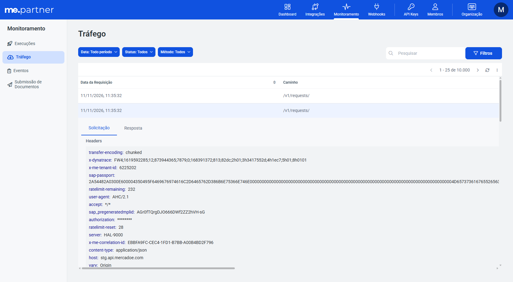
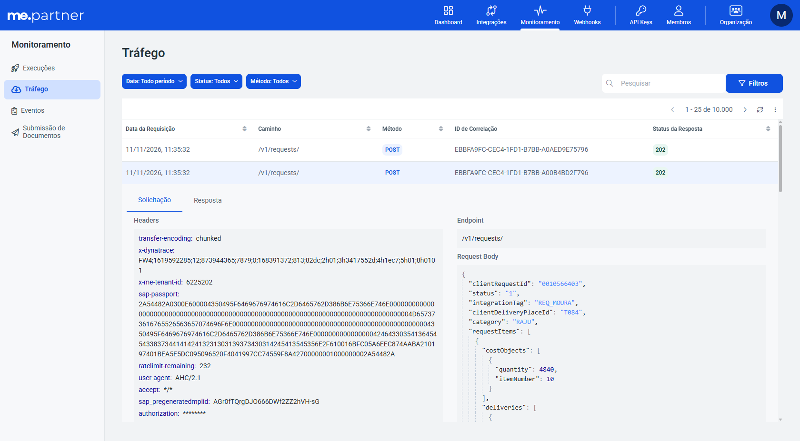

# Header longo não estoura mais o detalhe do Tráfego no Monitoramento

## Resumo
No detalhe do Tráfego, um header com valor longo e sem espaço esticava a tabela pra mais de 3700px. Agora o valor quebra dentro da coluna, e o layout cabe na tela.

## Problema
No detalhe expandido de Monitoramento > Tráfego, headers com valor longo e sem espaço (ex.: `sap-passport`) não quebravam linha. As colunas Método, ID de Correlação e Status saíam da tela, e o Request Body ficava fora da área visível.

## Por que
O detalhe do Tráfego ficava ilegível justamente nas chamadas com headers grandes.

## Como
- **`TrafficRequestDetail`:** `overflow-wrap: anywhere` nos itens da lista de headers, nas abas Solicitação e Resposta. É esse valor que reduz a largura mínima do conteúdo, então a tabela não estica antes de quebrar o texto. Com `overflow-wrap: break-word`, a quebra não funciona dentro da tabela.
- **`EventRequestDetail`:** o `word-break: break-word`, que é obsoleto, foi trocado pelo mesmo `overflow-wrap: anywhere`, sem mudar o comportamento de Eventos.

## Onde
partner-portal: Monitoramento > Tráfego (`TrafficRequestDetail`) e Eventos (`EventRequestDetail`)

## Resultado / impacto
Todas as colunas e o Request Body ficam visíveis, mesmo com header longo.

## Imagens
Antes: tabela estourada, só Data e Caminho visíveis e Request Body fora da tela.

Depois: header quebrado na coluna, todas as colunas visíveis e Request Body ao lado.

