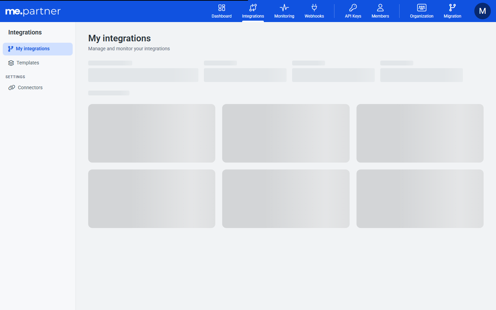
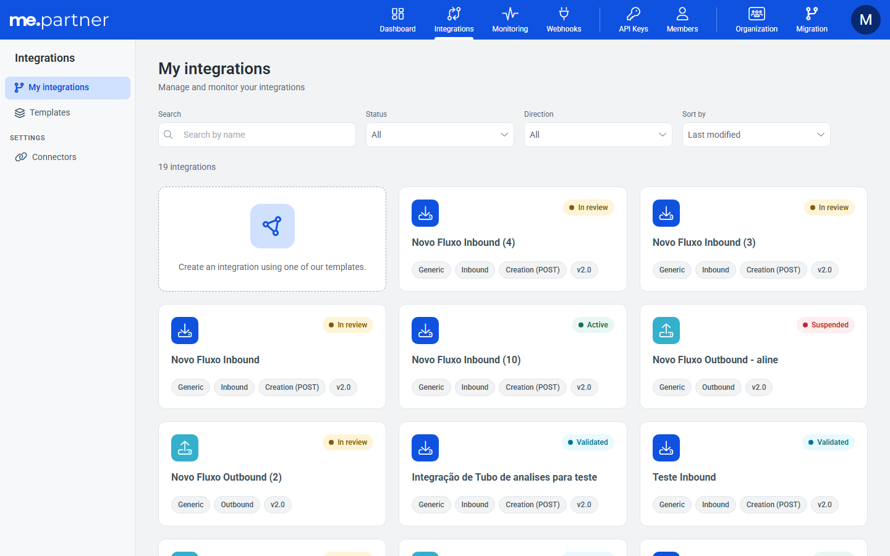

# Skeleton dos filtros e card compacto em Minhas Integrações

## Resumo
Em Minhas Integrações, a barra de filtros aparece como skeleton enquanto a lista carrega, e o skeleton dos cards tem a mesma altura do card compacto. A tela não pula mais de layout quando os dados chegam.

## Problema
Durante o carregamento, a barra de filtros não aparecia e o skeleton dos cards tinha altura diferente do card compacto real. Quando os dados chegavam, o layout pulava.

## Por que
Layout estável durante o carregamento.

## Como
- **`IntegrationCardSkeleton`:** nova prop `compact` (170px, a altura do card compacto). Um componente só pras duas telas.
- **Minhas Integrações:** a toolbar renderiza também durante o carregamento (`showToolbar`), com skeleton de label e campo pra busca, status, direção e ordenação, e uma linha no lugar do total. Usa `me-skeleton-text` do toolkit no mesmo grid da toolbar real.
- **Templates:** mantém o skeleton na altura atual (314px), com o mesmo componente. Lá não tem filtros, então não entrou skeleton de toolbar.
- **Testes:** caso novo cobrindo o skeleton dos filtros no lugar dos filtros reais durante o carregamento.

## Onde
partner-portal: Minhas Integrações, `IntegrationCardSkeleton`

## Resultado / impacto
Carregando e carregada têm as mesmas alturas (toolbar 110px, card 170px), sem salto de layout.

## Imagens
Carregando: skeleton dos filtros e cards compactos.

Carregada: mesmas alturas.

